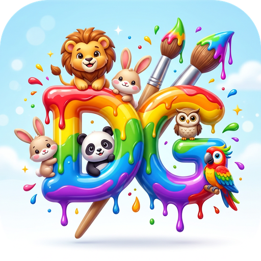
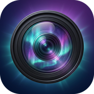
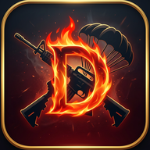

# DG Thaylon Apps

Apps Android gratuitos criados por **Douglas Thaylon** (Conceição do Araguaia, Pará, Brasil).

Site oficial: **https://dgthaylon.netlify.app/**

| App | O que é | Baixar |
|---|---|---|
|  **Educa DG 3.7** | App educativo infantil: jogos, matérias e livros narrados | [APK](https://github.com/Douglasthaylon/DG-Thaylon-Apps/raw/main/apks/Educa_DG_v3_7.apk) |
|  **Spark 5.0** | Rede social com feed, stories, filtros e chat | [APK](https://github.com/Douglasthaylon/DG-Thaylon-Apps/raw/main/apks/Spark_v5_0.apk) |
|  **Fala Aí 1.1** | Caixa de perguntas anônimas | [APK](https://github.com/Douglasthaylon/DG-Thaylon-Apps/raw/main/apks/FalaAi_v1_1.apk) |
|  **Sonix 1.3** | Música e clipes, com modo Kids | [APK](https://github.com/Douglasthaylon/DG-Thaylon-Apps/raw/main/apks/Sonix_v1_3.apk) |
|  **Lumora 1.0** | Câmera com ajustes, HDR e modo noturno | [APK](https://github.com/Douglasthaylon/DG-Thaylon-Apps/raw/main/apks/Lumora.apk) |
|  **DG.PLAY 1.0** | Filmes, desenhos e séries de canais oficiais | [APK](https://github.com/Douglasthaylon/DG-Thaylon-Apps/raw/main/apks/DG_PLAY.apk) |
|  **DG Cine 1.0** | Trailers e filmes em domínio público | [APK](https://github.com/Douglasthaylon/DG-Thaylon-Apps/raw/main/apks/DG_Cine.apk) |
|  **DG Royale 1.0** | Jogo battle royale: 30 jogadores, só um sobrevive | [APK](https://github.com/Douglasthaylon/DG-Thaylon-Apps/raw/main/apks/DG_Royale.apk) |

## Como instalar
1. Toque em **APK** do app que você quer.
2. Abra o arquivo baixado e permita "instalar apps desconhecidos" se o Android pedir.

Instagram: [@dg.thaylon](https://instagram.com/dg.thaylon)
